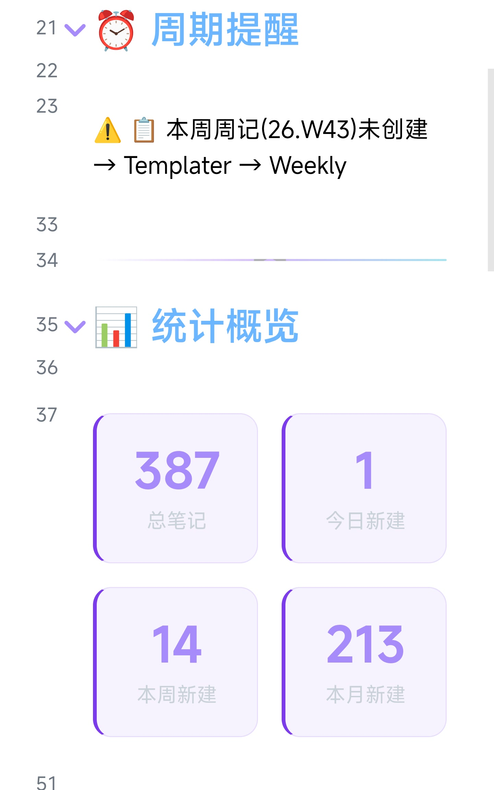
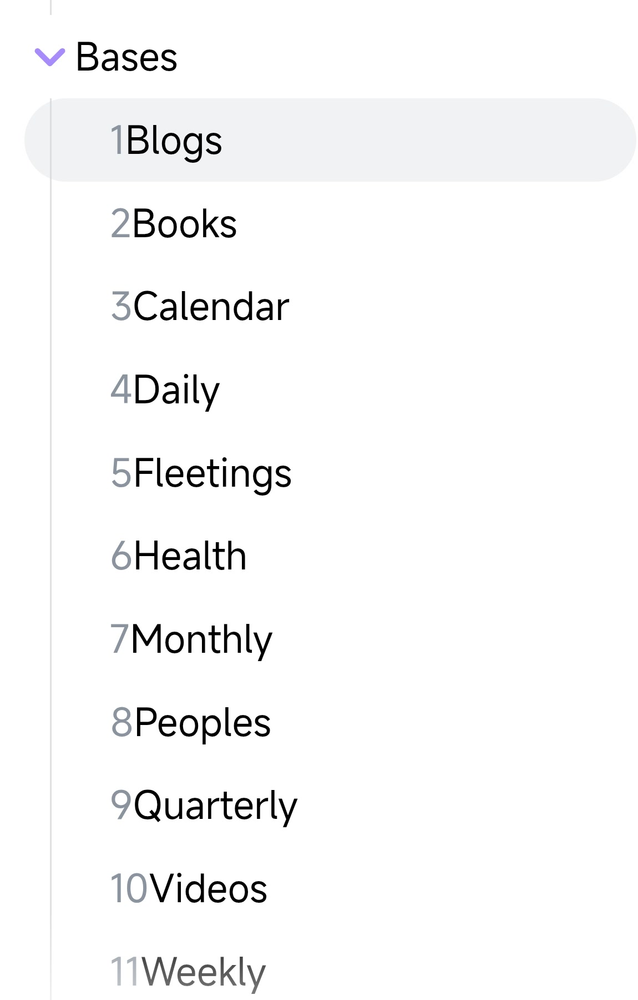
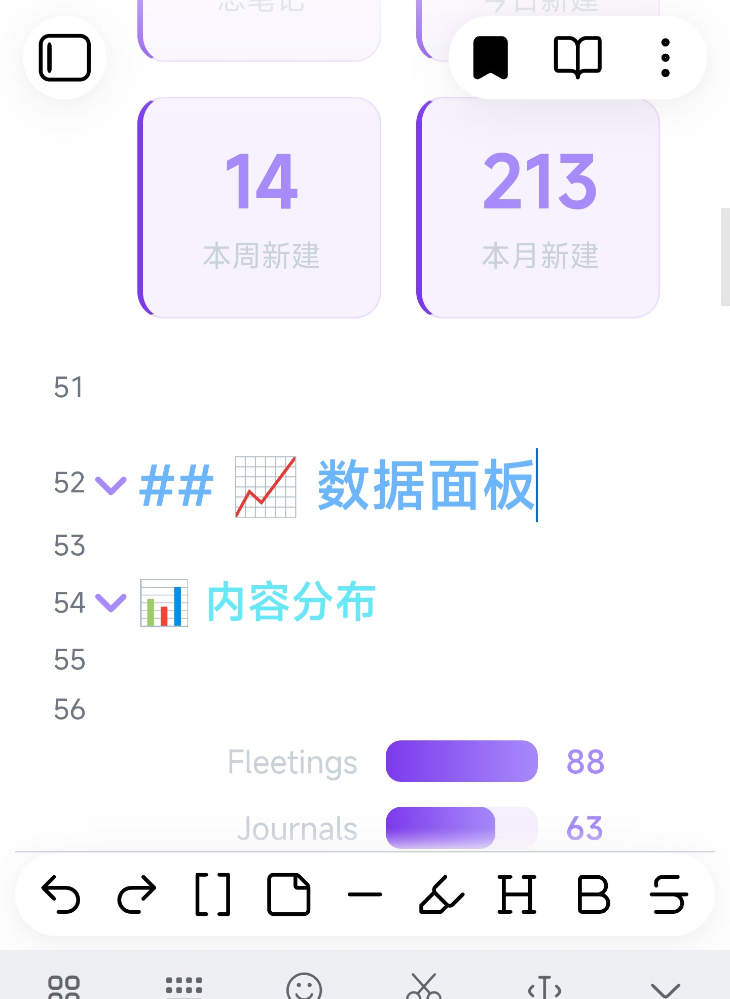

# Obsidian VisionJam Theme

> 9 个 CSS 片段 + 示例笔记 + 11 个 Templater 模板 + GitHub Theme 副本，为 GitHub Theme 深色模式设计。
>
> Nine CSS snippets, example notes, 11 Templater templates, and a bundled copy of GitHub Theme for a purple-accented Obsidian dashboard.

## 预览





## 包含什么

| 路径 | 内容 |
| --- | --- |
| `snippets/` | 9 个 CSS 片段：主页、索引页、标题、引用、标签、链接、属性、侧栏编号、折叠箭头 |
| `examples/` | 主页和索引页的示例笔记，含 Dataview / DataviewJS 查询 |
| `templates/` | 11 个 Templater 模板：日记、周记、月记、季记、年记、健康、博客、随想、人物、书籍、视频 |
| `themes/GitHub Theme/` | GitHub Theme 1.1.6 副本（MIT），方便一次下载 |
| `screenshots/` | 截图位 |
| `LICENSE` | 本仓库原创代码的 MIT 许可证 |
| `NOTICE.md` | 第三方致谢与来源说明 |

## 要求

- Obsidian 1.6 或更高版本；
- GitHub Theme 1.1.6（可选，仓库里带了一份）；
- Templater（使用 `templates/` 里的模板需要）；
- Dataview（主页示例和模板里的查询需要，且要在设置里启用 DataviewJS）；
- Simple Columns（可选，多栏 callout 需要）；
- Style Settings（可选，调 GitHub Theme 的选项）。

## 安装

1. 把 `snippets/` 里的 9 个 `.css` 复制到你的 `.obsidian/snippets/`；
2. 打开 Obsidian → 设置 → 外观 → CSS 片段，逐个启用；
3. 如果想用仓库里的主题，把 `themes/GitHub Theme/` 复制到 `.obsidian/themes/`，在 设置 → 外观 → 主题 里选择；
4. 把 `examples/` 整个目录复制进 vault（保留目录结构，这样示例里的链接能直接打开），或者只参考 frontmatter 和查询；
5. 主页示例需要在 Dataview 设置里启用 JavaScript 查询；
6. 多栏 callout 需要安装并启用 Simple Columns；
7. 如果没有生效，重启 Obsidian 或重新加载仓库。

## 用法

### 主页

在笔记 frontmatter 里加：

```yaml
---
cssclasses:
  - dashboard
---
```

主页 CSS 依赖示例里的 DataviewJS 生成的 class：`.vj-banner`、`.vj-stats`、`.vj-stat`、`.vj-bars`、`.vj-bar-*`。如果你用自己的主页，保留这些 class 名，或者改 `VisionJam-Homepage.css` 里的选择器。

### 索引页

在笔记 frontmatter 里加：

```yaml
---
cssclasses:
  - bases-index
---
```

`VisionJam-Bases.css` 样式化的是 Dataview 表格和日历，不是 Obsidian 官方 Bases 的 `.base` 文件。

### 全局片段

`Headers.css`、`Blockquote.css`、`Tags.css`、`Links.css`、`Properties.css`、`Sidebar-Numbering.css`、`Folding-Arrows.css` 启用后全局生效，不需要 frontmatter。

其中 `Sidebar-Numbering.css` 会给大纲和文件浏览器加层级编号；不想要就单独关掉它。

### 模板（Templater）

`templates/Templater/` 是文章里那 11 个模板：日记、周记、月记、季记、年记、健康、博客、随想、人物、书籍、视频。安装、依赖、落位脚本和已知坑都写在 [`templates/README.md`](templates/README.md)。

最短路径：

1. 安装 Templater 和 Dataview；
2. 把 `templates/Templater/` 复制到 vault 根目录；
3. 把每个模板里的 `TARGET_DIR` 改成你的目录；
4. 在 Templater 设置里配置文件夹模板，并在每台设备上打开 “Trigger Templater on new file creation”。

## 自定义

- 主色是 `#7c3aed`，hover 是 `#8b5cf6`；搜索替换即可换色；
- 标题色在 `Headers.css` 顶部，沿用了 GitHub Theme 的六色方案；
- 主页内容区背景是 `#1a1b2e`，边框和圆角也在 `VisionJam-Homepage.css` 里；
- 标签、链接、引用块的颜色分别在 `Tags.css`、`Links.css`、`Blockquote.css`；
- 如果你在 Windows 上用，保留“不要 `backdrop-filter`、不要 `-webkit-font-smoothing: antialiased`”这两个取舍，字会清楚很多。

## 排错

- **片段启用了但没变化**：确认文件扩展名是 `.css`，不是 `.md`；确认在 设置 → 外观 → CSS 片段 里打开了；重启 Obsidian。
- **DataviewJS 不渲染**：在 Dataview 设置里启用 JavaScript 查询；代码块语言必须是 `dataviewjs`，不是 `dataview`。
- **多栏 callout 不生效**：安装并启用 Simple Columns；语法是 `> [!multi-column]` 包住 `> [!column]`。
- **颜色和截图不一样**：这些片段假设你在用 GitHub Theme 深色模式；换主题后变量会覆盖，需要自己调。
- **移动端排版不对**：这些片段主要在 Windows 上测试；窄屏下表格卡片化可能需要再调。

## 来源与许可证

- 本仓库原创的 CSS、示例笔记和 Templater 模板使用 MIT 许可证，见 `LICENSE`。
- GitHub Theme 由 [krios2146](https://github.com/krios2146/obsidian-theme-github) 开发，MIT 许可，Copyright 2023 Vladimir Kidyaev。`themes/GitHub Theme/` 里的副本为了方便下载而内置，许可证见该目录下的 `LICENSE`。
- 部分片段的设计参考过 Klaas 的 Obsidian CSS snippets 合集；本仓库里的公开版本是重写的，没有直接复制原代码。详见 `NOTICE.md`。
- Obsidian 是 Dynalist Inc. 的商标；本仓库与官方无关。
